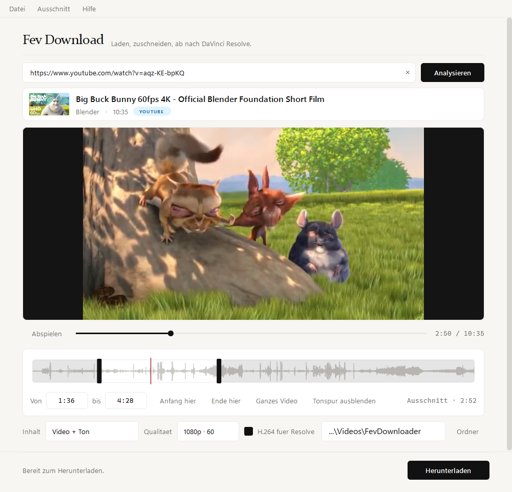

# Fev Download

Lädt Videos von YouTube und über tausend weiteren Plattformen, schneidet den
gewünschten Ausschnitt heraus und übergibt ihn direkt an DaVinci Resolve.



## Was es kann

- **Jeder Video-Link** — YouTube, Vimeo, TikTok, Twitch und viele mehr (über `yt-dlp`)
- **Vorschau ohne Warten** — das Video wird direkt gestreamt, nichts wird vorab geladen.
  Geht das nicht (TikTok und einige andere geben ihre Adressen nur mit besonderen
  Kopfdaten heraus), lädt die App still eine kleine Datei und spielt diese ab
- **Hochformat wird richtig dargestellt** — TikTok, Reels und Shorts bekommen eine hohe,
  schmale Bildfläche statt klein zwischen zwei schwarzen Balken zu sitzen
- **Ausschnitt wählen** — Anfang und Ende ziehen oder als Zeit eintippen; geschnitten
  wird bereits beim Laden, ein 30-Sekunden-Ausschnitt aus einem Zweistünder zieht also
  nur einen Bruchteil der Daten
- **Die Vorschau folgt dem Griff** — beim Ziehen springt das Bild sofort an diese Stelle
  und die Zeit steht über dem Griff. Man sieht also genau, an welchem Bild geschnitten
  wird, statt nur eine Zahl zu lesen
- **Mehrere Stellen aus einem Video** — Ausschnitt setzen, **+ Ausschnitt** drücken,
  nächste Stelle suchen, wieder drücken. Alle gemerkten Stellen werden nacheinander
  geladen und jede wird eine eigene Datei
- **Tonspur sichtbar machen** — Lautstärkeverlauf im Ausschnitt-Balken, damit man sieht,
  wo ein Lied anfängt und aufhört
- **Video + Ton, nur Ton oder nur Video** — in jeder Qualität, die es beim Video gibt
- **Automatisch im Media Pool** — beim Start aus Resolve heraus landet der fertige Clip
  im offenen Projekt
- **Bibliothek mit Vorschaubildern** — bereits geladene Video- und Audiodateien im
  Zielordner durchsuchen, nach Typ und Datum filtern, sortieren, öffnen oder direkt an
  Resolve übergeben. Zu jedem Video gibt es ein Standbild

## Installieren

**`FevDownloadSetup.exe` herunterladen, doppelklicken, fertig.**

Es wird nichts weiter gebraucht — kein Python, kein ffmpeg, keine
Kommandozeile. Alles steckt in dieser einen Datei.

> **Windows zeigt eine Warnung.** *„Der Computer wurde durch Windows
> geschützt"* — die erscheint bei jedem Programm ohne gekaufte Signatur.
> Auf **Weitere Informationen** klicken, dann auf **Trotzdem ausführen**.

Der Installer legt das Programm unter `%LOCALAPPDATA%\Programs\FevDownload` ab,
bindet es in DaVinci Resolve ein und legt auf Wunsch eine Verknüpfung auf dem
Desktop an. **Administratorrechte braucht er nicht.**

Danach **Resolve einmal neu starten** — Scripts liest es nur beim Start ein.

Deinstalliert wird ganz normal über *Einstellungen → Apps* oder den Eintrag im
Startmenü. Die heruntergeladenen Videos bleiben dabei erhalten.

### Voraussetzungen

- Windows (64 Bit)
- DaVinci Resolve — nur für den Import in den Media Pool. Ohne Resolve
  funktioniert alles andere genauso, die Dateien landen dann im gewählten Ordner.

## Wenn eine Plattform nicht mehr geht

YouTube und die anderen ändern regelmäßig etwas an ihren Seiten. Das Werkzeug
dahinter (`yt-dlp`) zieht meist binnen Tagen nach — die mitgelieferte Fassung
ist aber auf den Stand eingefroren, an dem das Programm gebaut wurde.

Deshalb: **Hilfe → Nach Aktualisierung suchen.** Das holt die neueste Fassung
und wirkt beim nächsten Start. Ein neuer Installer ist dafür nicht nötig.

## Benutzung

### Aus DaVinci Resolve heraus

**Workspace → Scripts → Utility → FevDownloader**

Ein grüner Streifen im Fenster bestätigt die Verbindung. Jeder fertige Download
wandert automatisch in den Media Pool des offenen Projekts. Man kann mehrere Clips
nacheinander laden; zum Beenden das Fenster schließen.

### Eigenständig

Doppelklick auf **Fev Download** auf dem Desktop oder im Startmenü. Die Dateien
landen dann nur im gewählten Ordner, ohne Resolve-Import.

### Ablauf

1. Link einfügen — oder auf das Fenster ziehen. Liegt beim Start ein Link in der
   Zwischenablage, steht er schon im Feld.
2. **Analysieren**
3. Vorschau abspielen, Ausschnitt setzen (Griffe ziehen, Zeiten tippen oder die
   Tasten `I` und `O` an der Abspielposition). Beim Ziehen springt die Vorschau mit —
   man sieht das Bild, an dem geschnitten wird.
4. Inhalt und Qualität wählen
5. **Herunterladen** — danach wird der Knopf zu **Fertig** und schließt das Fenster

Der Download läuft im Hintergrund weiter, wenn man das Fenster minimiert.

### Mehrere Stellen aus einem Video

Manchmal braucht man nicht einen Ausschnitt, sondern zwei oder drei aus demselben
Video — den Anfang und das Ende zum Beispiel.

1. Ersten Ausschnitt setzen wie gewohnt
2. **+ Ausschnitt** drücken (oder Taste `M`) — er wandert auf die Liste unter dem Balken
3. Nächste Stelle suchen, wieder **+ Ausschnitt**
4. **Herunterladen** — der Knopf heißt jetzt „3 Ausschnitte laden"

Jede Stelle wird eine eigene Datei; der Zeitbereich steht im Dateinamen. Aus Resolve
heraus wandert jeder fertige Teil sofort in den Media Pool, ohne auf die übrigen zu
warten.

Bis zu drei Ausschnitte werden **gleichzeitig** geladen. Das lohnt sich, weil die
Plattformen jede einzelne Verbindung drosseln, nicht die Leitung: Drei Ausschnitte
brauchen zusammen kaum länger als einer allein — gemessen 17 statt 42 Sekunden.

Die gemerkten Stellen erscheinen als nummerierte Blöcke unter dem Balken. Ein Klick
darauf — oder ein Doppelklick in der Liste — holt den Ausschnitt zum Nachbessern
zurück. Solange etwas auf der Liste steht, wird sie geladen und nicht der gerade
eingestellte Bereich.

### Bibliothek

Oben rechts führt **Bibliothek** zu allen Medien im aktuell gewählten Zielordner.
Unterordner werden mit durchsucht. Die Liste zeigt ein Vorschaubild, Name, Typ, Format,
Datum und Dateigröße und lässt sich durchsuchen, filtern und sortieren. Ein Doppelklick
öffnet die ausgewählte Datei. Wurde Fev Download aus Resolve gestartet, kann eine
vorhandene Datei mit **In Media Pool** an das offene Projekt übergeben werden.

Die Vorschaubilder entstehen im Hintergrund und werden gemerkt — beim ersten Blick in
einen vollen Ordner erscheinen sie nach und nach, danach sofort. Tonspuren zeigen ihr
eingebettetes Titelbild, sofern eines vorhanden ist.

Über **Ordner wechseln** lässt sich auch ein älterer Download-Ordner einlesen. Dieser
Ordner wird zugleich zum neuen Ziel für weitere Downloads.

### Tastenkürzel

| Taste | Wirkung |
|---|---|
| `Strg` + `V` | Link aus der Zwischenablage einfügen |
| `Strg` + `Enter` | Analysieren |
| `I` | Anfang des Ausschnitts auf die Abspielposition |
| `O` | Ende des Ausschnitts auf die Abspielposition |
| `M` | Ausschnitt auf die Liste merken |
| `Strg` + `O` | Zielordner wählen |
| `Strg` + `L` | Bibliothek öffnen |
| `Strg` + `Q` | Beenden |

## Der Haken „H.264 für Resolve"

YouTube liefert 1440p und 4K nur in den Formaten VP9 oder AV1 aus — **DaVinci
Resolve kann beide nicht öffnen.** Ist der Haken gesetzt, wird notfalls nach H.264
umgewandelt. Das dauert länger, dafür lässt sich die Datei sicher importieren.
Bis einschließlich 1080p ist meist ohnehin H.264 verfügbar und es wird nichts
umgewandelt.

## Wie es aufgebaut ist

Seit Version 19.1 lässt die kostenlose Resolve-Version **kein Scripting von außen**
mehr zu. Nur ein Script, das Resolve selbst startet, erreicht die Schnittstelle.
Daraus ergibt sich der Aufbau:

```
Resolve: Workspace → Scripts → FevDownloader
   │
   ├─ schreibt job.json, startet die Oberfläche als eigenes Programm
   │                                    │
   │                                    ├─ Link, Vorschau, Ausschnitt, Download
   │                                    └─ schreibt result.json
   │                                    ▼
   └─ liest result.json → ImportMedia() → Clip liegt im Media Pool
```

Das Script in Resolve nutzt ausschließlich die Standardbibliothek, weil es unter
Resolves eigenem Python (`fuscript.exe`) läuft — nicht unter der Umgebung des
Projekts.

### Dateien

```
davinciplugin/
├── CLAUDE.md                 Arbeitswissen für Entwicklung und KI-Assistenten
├── setup.ps1                 Einrichtung: Umgebung, Pakete, ffmpeg, Symbol
├── install_plugin.ps1        Einbindung in Resolve
├── run_gui.ps1               Oberfläche starten (Entwicklung)
├── build_installer.ps1       Baut FevDownloadSetup.exe zum Weitergeben
├── fevdl.spec                Bauplan für PyInstaller
├── installer/FevDownload.iss Bauplan für den Installer
├── launch.pyw                Startet die Oberfläche ohne Konsolenfenster
├── bin/                      ffmpeg.exe, ffprobe.exe (lokal)
├── assets/fevdl.ico          Programmsymbol
├── tests/                    Testreihe, run_tests.ps1
├── tools/make_icon.py        Erzeugt das Symbol
├── resolve/FevDownloader.py  Läuft IN Resolve, holt Clips in den Media Pool
└── src/fevdl/
    ├── paths.py              Zentrale Pfade
    ├── ipc.py                job.json / result.json
    ├── cli.py                Kommandozeile zum Prüfen des Download-Motors
    ├── core/
    │   ├── models.py         Datentypen
    │   ├── probe.py          Metadaten und verfügbare Qualitäten
    │   ├── download.py       Download mit Modus, Qualität, Ausschnitt
    │   ├── waveform.py       Lautstärkeverlauf der Tonspur
    │   ├── thumbs.py         Vorschaubilder für die Bibliothek
    │   └── errors.py         Verständliche Fehlermeldungen
    └── gui/
    ├── main_window.py    Hauptfenster
    ├── library_page.py   Bibliothek mit Suche, Filtern und Dateiliste
    ├── preview_player.py Vorschau-Player
        ├── trim_bar.py       Ausschnitt-Balken mit Wellenform
        ├── worker.py         Hintergrund-Threads
        ├── typography.py     Schriften
        └── style.py          Farben und Rahmen
```

## Wenn etwas nicht klappt

**Windows warnt beim Installieren**
*„Der Computer wurde durch Windows geschützt"* → **Weitere Informationen** →
**Trotzdem ausführen**. Die Warnung erscheint bei jedem Programm ohne gekaufte
Signatur und sagt nichts über den Inhalt aus.

**`FevDownloader` fehlt im Scripts-Menü**
Resolve neu starten. Scripts werden nur beim Start eingelesen.

**„Die Datei install.json fehlt"**
Den Installer noch einmal ausführen. (Aus dem Quelltext heraus:
`install_plugin.ps1`.)

**Ein Video lässt sich nicht mehr laden**
**Hilfe → Nach Aktualisierung suchen**, danach das Programm neu starten. Die
Plattformen ändern regelmäßig etwas; das behebt es in den meisten Fällen.

**Die Vorschau braucht bei TikTok ein paar Sekunden**
Das ist so gewollt. Dort lässt sich nicht streamen, deshalb wird eine kleine Datei
geladen. Bei den üblichen kurzen Videos dauert das nur einen Moment.

**Resolve lehnt die Datei ab**
Der Codec passt nicht. Den Haken „H.264 für Resolve" gesetzt lassen und erneut laden.

**Etwas anderes**
Das Protokoll steht in `%LOCALAPPDATA%\FevDownloader\launcher.log`.

## Für Entwickler

Wer am Projekt weiterarbeitet — Mensch oder KI — findet in
**[CLAUDE.md](CLAUDE.md)** das gesammelte Arbeitswissen: warum der Aufbau so ist,
welche Fallstricke es gibt und woran man beim Ändern denken muss.

### Aus dem Quelltext einrichten

Voraussetzung ist hier zusätzlich **Python 3.11 oder neuer**.

```powershell
powershell -ExecutionPolicy Bypass -File setup.ps1
powershell -ExecutionPolicy Bypass -File install_plugin.ps1
```

`setup.ps1` legt eine eigene Python-Umgebung im Projektordner an, installiert
`yt-dlp` und `PySide6` und lädt `ffmpeg` nach `bin/`. **Es wird nichts systemweit
installiert** — löscht du den Projektordner, ist alles wieder weg.

`install_plugin.ps1` kopiert das Startscript in DaVinci Resolve.

Beide Bauarten laufen nebeneinander: Das Script in Resolve nimmt die
installierte `FevDownload.exe`, wenn es sie findet, und sonst die Python-Umgebung
des Projekts.

### Installer bauen

```powershell
powershell -ExecutionPolicy Bypass -File build_installer.ps1
```

Ergibt `dist\FevDownloadSetup.exe` (rund 97 MB) — die eine Datei, die
weitergegeben wird. Nötig sind dafür PyInstaller
(`.venv\Scripts\python.exe -m pip install pyinstaller`) und
[Inno Setup 6](https://jrsoftware.org/isdl.php).

### Tests

```powershell
powershell -ExecutionPolicy Bypass -File tests\run_tests.ps1
powershell -ExecutionPolicy Bypass -File tests\run_tests.ps1 -MitNetz
```

Zwölf Tests laufen ohne Internet und dauern zusammen etwa eine halbe Minute. Sie
decken Datenaustausch, Oberfläche, das Resolve-Script, Hochformat, mehrere
Ausschnitte und sauberes Beenden ab. Mit `-MitNetz` kommen vier Tests dazu, die
wirklich etwas laden.

### Download-Motor ohne Oberfläche prüfen

```powershell
$env:PYTHONPATH = "src"
.venv\Scripts\python.exe -m fevdl.cli probe "<link>"
.venv\Scripts\python.exe -m fevdl.cli get "<link>" --mode video_audio --height 1080 --start 1:00 --end 1:30
```

## Rechtliches

Gedacht für eigene Inhalte oder Material, dessen Lizenz das Herunterladen erlaubt.
Die Nutzungsbedingungen der jeweiligen Plattform gelten weiterhin.
